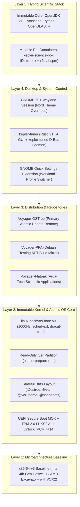

# Kepler OS (Immutable Atomic Edition)

[](https://www.gnu.org/licenses/gpl-3.0)
[-88C0D0.svg)](https://en.wikipedia.org/wiki/X86-64#Microarchitecture_levels)
[-D70A53.svg)](https://www.debian.org/testing/)
[](https://ostreedev.github.io/ostree/)

Kepler OS is an immutable, atomic rolling-release Linux distribution engineered for scientific researchers, bioinformaticians, and performance enthusiasts. It pairs the stability of **Debian Testing** with the high-throughput **CachyOS BORE** kernel, an immutable **OSTree** system root, and the minimal **GNOME 50+** desktop styled in the Nord palette.

---

## 1. System Architecture



---

## 2. Quick Start for Developers (Containerized Build)

All build operations execute inside an isolated container environment. **Do not install build dependencies on your host operating system.**

### Step 1: Initialize Workspace and Builder Container
```bash
git clone https://github.com/Antux912012/kepler-os.git
cd kepler-os
make init-tree
make builder
```

### Step 2: Generate Cryptographic Keys and Assemble OSTree Commit
```bash
make mok-keys
make ostree-commit
```

### Step 3: Run Supply-Chain Attestation & CVE Scans
```bash
make sbom
make scan-cve
```

### Step 4: Compile Bootable Live ISO & Run Verification Test Harness
```bash
make iso
make test-iso        # Tests Live ISO boot with Haswell-v4 OVMF Secure Boot
make test-installed  # Tests deployed OSTree NVMe image and read-only /usr
make test-rollback   # Validates atomic ostree admin upgrade and rollback
make test-tpm2-luks  # Validates unattended TPM 2.0 (swtpm) LUKS2 auto-unlock
```

---

## 3. Compliance, Disclaimers & Credits Summary

- **License:** Kepler OS is distributed under the [GNU General Public License v3.0 or later](file:///home/antonio/Projects/Project_Kepler_OS/kepler-os-build/LICENSE) (`GPL-3.0-or-later`).
- **Legal Non-Affiliation:** Kepler OS and the Voyager project are independent open-source initiatives with no affiliation, association, or endorsement by NASA, ESA, or third parties. See [NOTICE.md](file:///home/antonio/Projects/Project_Kepler_OS/kepler-os-build/NOTICE.md).
- **EU AI Act & CRA Attestation:** Verified supply-chain security and local AI runtime transparency details are documented below.

<!-- EU_COMPLIANCE_TABLE_START -->


## EUROPEAN UNION REGULATORY & SUPPLY-CHAIN ATTESTATION (ASD-STE100)

| Regulation / Standard | Article / Annex | Kepler OS Immutable Technical Control | Verification Artifact / Command |
| :--- | :--- | :--- | :--- |
| **EU AI Act (Reg. EU 2024/1689)** | Article 50 (AI Transparency) | Discloses AI-assisted build code generation and mandates local-only execution for Arda-Tech AI runtimes (*Sulimo* / *Elrond Assistance*) with zero cloud telemetry. | `NOTICE.md`, `.github/workflows/lint-pr-compliance.yml` |
| **EU Cyber Resilience Act (Reg. EU 2024/2847)** | Annex I, Part II (SBOM) | Generates machine-readable **SPDX 2.3 (`.spdx.json`)** and **CycloneDX 1.5 (`.cdx.json`)** Software Bills of Materials for every OSTree commit and Live ISO. | `make sbom`, `scripts/verify-release-sbom.sh` |
| **EU Cyber Resilience Act (Reg. EU 2024/2847)** | Annex I, Part II (Vulnerability Handling) | Scans every release SBOM with **Trivy** and **Grype**, blocks fixable `CRITICAL` CVEs, and uploads SARIF 2.1.0 reports to GitHub Code Scanning. | `make scan-cve`, `kepler-cve-trivy.sarif` |
| **EU Cyber Resilience Act (Reg. EU 2024/2847)** | Article 24 (Coordinated Vulnerability Disclosure) | Establishes a 48-hour acknowledgment and 14-day patch window via GitHub Private Vulnerability Reporting and GPG-encrypted advisories. | `SECURITY.md` |
| **EU Cyber Resilience Act (Reg. EU 2024/2847)** | Annex I, Part I (Integrity & Secure Boot) | Enforces read-only `/usr` via **OSTree**, signs kernels with UEFI Secure Boot **MOK**, binds LUKS2 to **TPM 2.0 (PCR 7+14)**, and signs all release artifacts with GPG. | `make mok-keys`, `kepler-enroll-tpm2`, `SHA256SUMS.gpg` |
| **Outbound Licensing & Provenance** | GNU GPL v3.0 & DCO 1.1 | Enforces `SPDX-License-Identifier: GPL-3.0-or-later` headers across all files and DCO `Signed-off-by:` trailers on every commit. | `make spdx-headers`, `make git-hooks` |

<!-- EU_COMPLIANCE_TABLE_END -->
